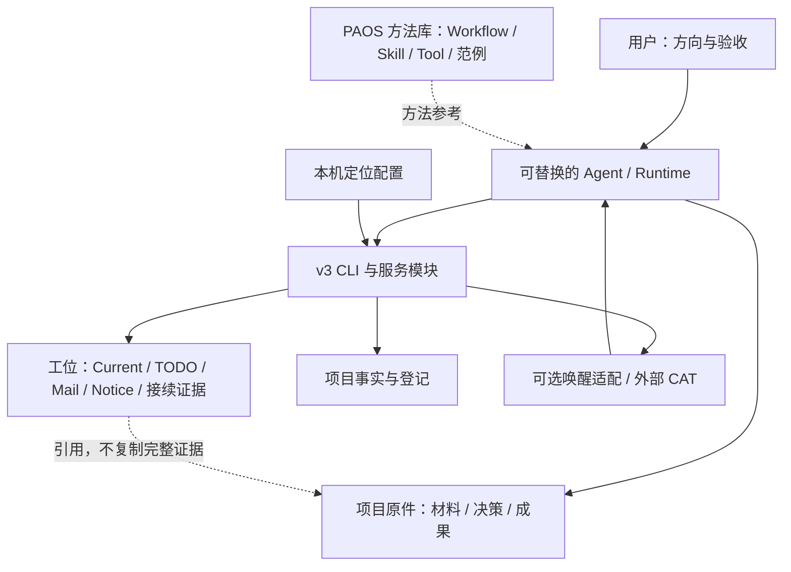

# PAOS Portable：架构与资产边界

本文件是 Portable 的组成和迁移边界说明；业务工作规程仍以 `libraries/workflow/CATALOG.md` 所指正文为准，不在仓库文档复制第二套工位规程。

## 1. 目标：硬基座稳定，软协作可变

硬基座围绕项目事实、文件定位、受约束写入与可追溯回执。Workflow / Skill / Tool 等库提供方法参考与复用经验，而非把每件事改成强制审批。

上层利用工位指南、TODO、Notice 和持续接续约定驱动 Agent 主动工作；CAT、唤醒器和 Runtime 适配负责实际投递与运行接续。CAT 是外部可选协作组件，不是这份仓库已经内置并启动的服务。

图表示职责关系，不意味着所有箭头已在新机器验收。当前包缺少旧 HTTP 服务目录；涉及该目录中后端模块的能力必须逐项核依赖，不能因为目录名含 dashboard 就视作纯 UI。

## 2. 不把三个维度混在一起

| 维度 | 应回答的问题 | 例子 |
|---|---|---|
| 硬机制 / 软约定 | 谁执行约束？ | TODO 字段校验是硬机制；何时主动回读、如何写进展是软约定 |
| 系统 / 项目 | 资产归谁、谁复用？ | Workflow 是共享方法；某项目的 Coordinator TODO 是项目责任 |
| 耐久事实 / 本机绑定 / 派生视图 | 换机应带走、重新建立，还是重建？ | 决策带走；接收器重新绑定；Catalog 重建 |

**Markdown 是存储格式，不是“没有合同”的保证。** 普通材料可以直接编辑；结构化 TODO、Mail、Notice 和 Project 状态应走其既有校验与写入路径。人能用 Obsidian 阅读，不等于可以绕过指纹、revision、回执与原子写入。

同样，文件放在 `data/` 或 `.paos/` 不意味着它都是缓存：原始事件是证据，索引才是派生物。

## 3. 各部分保留什么

| 部分 | 保留与复用 | 不默认携带或恢复 |
|---|---|---|
| 代码硬基座 | CLI、必要的服务/写者、安装定位、适配代码及相应测试 | 缓存、构建输出、无证据支撑的整套历史运行环境 |
| 方法库 | Guide、Workflow、Template、Skill、Tool 定义及参考范例 | 原机工具“已安装/在线”的断言 |
| Rooter | 安装级维护工位、当前责任、必要证据与引用 | 原机原生会话、PID、端口、管道、在线身份 |
| 选定项目 | 项目事实、现任 Coordinator 工位、决策、未完成输入与所引用成果 | 默认启动所有历史执行工位 |
| 本机配置 | 新机器上显式生成的唯一安装定位 | 沿用旧机器已有效的连接与唤醒状态 |

Rooter 是安装级角色，不硬塞进某个项目的人员表。每个迁入项目保留一个**实际登记的现任 Coordinator**，不能把历史角色名称或某个固定编号当现状。

“只保留这两类工位”是最小接续范围，不是删档许可。其他执行工位可按需重新登记；仍需使用的原始输入、交付、回执和历史引用继续可达。STOP 等耐久控制事实不能被“换机初始化”悄悄清除。

## 4. 工位与项目事实如何配合

工位保留短期动态责任：现在做什么、阻塞在哪里、下一步是什么。达到成果或决策节点后，长期内容沉淀到项目原件或复用库，工位留简短结论与可验证引用。

这不是“工位不重要”：工位保存接班所需的动态责任；也不是“工位另建事实库”：不要把整份证据在 TODO 和成果文件里分别维护。库内案例优先保留可以回到真实输入、过程取舍和结果的完整引用链，而不只保留抽象口诀。

## 5. 写入和投递边界

现有核心约定区分 Project 状态写者与 Home 文件写者。不能为“统一存储”把两者揉成另一个数据库，也不能直接拼改 Project JSON 来绕过对应合同。Portable 初始化助手只生成安装定位，不处理这两类业务写入。

持久留信、生成 Notice、接受唤醒、Agent 实读、交付、验收是不同事实。保持原有区分，不新增第二套任务生命周期或自动重试器；尤其不得因投递结果不确定就在新机器盲目重发旧输入。

## 6. 收敛顺序

先使安装定位可解释且可重复，再恢复真实代码与测试的依赖闭合，最后用 Rooter + 一个项目 Coordinator 验证业务接续。只有该闭环实际成立，才讨论扩大工位范围或继续裁减兼容代码。

拆文件是实现手段，不是验收目标。判断简化是否成立，要看权威写入路径、隐含环境依赖和重复状态是否减少，而不是只看主文件行数。
