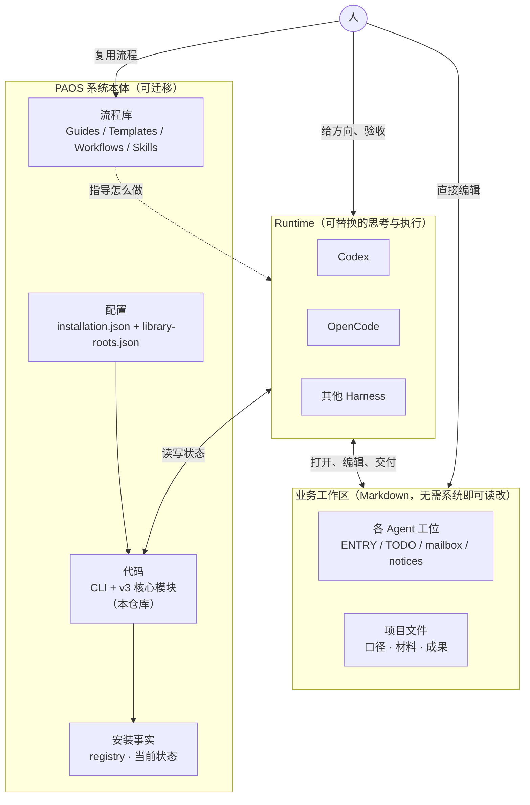

# PAOS 体系架构

> 一套**可迁移、可复用**的本机多 Agent 工作系统。系统管机制，流程库管方法，业务文件是 Markdown、人和 Agent 都能直接改。

## 一张图看懂



## 三层各管一件事

| 层 | 管什么 | 形态 | 换电脑怎么办 |
| --- | --- | --- | --- |
| **系统本体** | 怎么存状态、怎么登记、怎么唤醒、怎么读写工位 | 代码（Git 仓库）+ 配置 | clone + 改路径 |
| **流程库** | 怎么干活：可复用的流程、指南、模板、技能 | Markdown（Libraries） | 打包带走 |
| **业务工作区** | 具体哪个项目、哪个任务、什么口径 | **Markdown，人可直接改** | 按需搬，不属系统 |

**关键边界**：系统不拥有业务内容。工位 TODO、项目口径、流程正文都是普通 Markdown——你可以用任何编辑器（包括 Obsidian）直接打开改，**不需要经过 PAOS 的工具**。系统只负责"这些文件怎么被登记、被读取、被唤醒接续"，不负责"内容必须长什么样"。

## 数据怎么流

```
留信（mail body）
  → 登记（notice）
  → 唤醒（wake trigger，可选）
  → 收件 Agent 实读处理（handle）
  → 业务交付与验收
```

每一步独立成立，前一步成功不代表后一步完成。Runtime 可以换、会话可以关，**工位和 Current 责任留在 Markdown 里，不随某个对话消失**。

## 流程库（可复用的方法资产）

流程库是这套体系里**最有复用价值的部分**——它是"怎么把一类事做好"的沉淀，人与 Agent 共用：

```
libraries/
├─ workflow/
│  ├─ Guides/       方法指南（工作循环、运行时交接、文档编辑、安装等）
│  ├─ Templates/    可复用模板（工位 ENTRY / TODO、采用结果、发布指南等）
│  ├─ Workflows/    流程（Agent 工作循环、治理循环、夜间维护等）
│  └─ CATALOG.md    索引（生成，可重建）
├─ skill/           技能库（每个含 SKILL.md，部分带 references 示例）
└─ tool-catalog.md  本机执行工具索引（真实任务核实后登记）
```

**这些是给人看的，也是给 Agent 看的。** 你改一份 Guide，所有按它工作的 Agent 下次就照新的来——流程即资产，改即生效。

## 本仓库（代码）是什么

PAOS 主程序：CLI、核心模块、本地 HTTP 服务、Runtime 适配。

- **v3 正常路径**：`scripts/paos.py` + `paos_*` 模块，直接对工位文件与 ProjectStore 读写。
- **v2 历史链**：本地 HTTP 服务（内部兼容，非业务入口）。
- 核心模块克制（安装定位、工位、TODO、邮件、通知、唤醒、库生成），数据全是 JSON / Markdown，无重型依赖。

CAT 圆桌在独立仓库 [`co-agent-2`](https://github.com/xiangscream/co-agent-2)，仅通过 HTTP 消费，是协作传输层，不是第二套工作系统。

## 设计原则（这套体系为什么长这样）

- **轻量**：localhost + JSON/files + 标准库 + browser UI，不引入微服务/分布式/复杂权限。
- **易懂**：工程结构可以轻，认知结构不能乱——系统、流程、业务三层分清楚。
- **可再编译**：真正长期保存的是"规格 + 真实数据 + 可复用流程"，代码按 commit 重建。
- **业务文件归人**：工位与项目文件是 Markdown，人和 Agent 都能直接编辑，系统不锁死内容。
