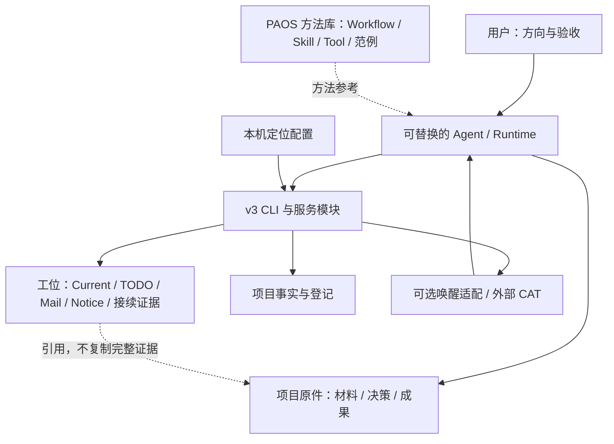

# PAOS Portable：架构与资产边界

本文件是 Portable 的组成和迁移边界说明；业务工作规程仍以 `libraries/workflow/CATALOG.md` 所指正文为准，不在仓库文档复制第二套工位规程。

## 1. 目标：硬基座稳定，软协作可变

硬基座围绕 Agent 的文件定位、工位读写、持久输入与显式运行通道。Workflow / Skill / Tool 等库提供方法参考与复用经验，而非把每件事改成强制审批。

上层利用工位指南、TODO、Notice 和持续接续约定驱动 Agent 主动工作；CAT、唤醒器和 Runtime 适配负责实际投递与运行接续。CAT 是外部可选协作组件，不是这份仓库已经内置并启动的服务。

图表示职责关系，不意味着所有箭头已在新机器验收。常用工位与库命令已脱离旧 HTTP 服务。ProjectRegistry 用五字段最小登记定位项目与工位，允许显式首次登记而不覆盖已有文件；Home 写者继续维护工作。本片不恢复旧服务和全部 ProjectStore 管理接口。

## 2. 不把三个维度混在一起

| 维度 | 应回答的问题 | 例子 |
|---|---|---|
| 硬机制 / 软约定 | 谁执行约束？ | TODO 字段校验是硬机制；何时主动回读、如何写进展是软约定 |
| 系统 / 项目 | 资产归谁、谁复用？ | Workflow 是共享方法；某项目的 Coordinator TODO 是项目责任 |
| 耐久事实 / 本机绑定 / 派生视图 | 换机应带走、重新建立，还是重建？ | 决策带走；接收器重新绑定；Catalog 重建 |

**Markdown 是存储格式，不是“没有合同”的保证。** 普通材料可以直接编辑；结构化 TODO、Mail、Notice 和 Project 状态应走其既有校验与写入路径。人能用 Obsidian 阅读，不等于可以绕过指纹、revision、回执与原子写入。

同样，文件放在 `data/` 或 `.paos/` 不意味着它都是缓存：原始事件是证据，索引才是派生物。

## 3. 各部分保留什么

| 部分 | 保留与复用 | 不默认携带或恢复 |
|---|---|---|
| 代码硬基座 | CLI、必要的服务/写者、安装定位、适配代码及相应测试 | 缓存、构建输出、无证据支撑的整套历史运行环境 |
| 方法库 | Guide、Workflow、Template、Skill、Tool 定义及参考范例 | 原机工具“已安装/在线”的断言 |
| Rooter | 安装级维护工位、当前责任、必要证据与引用 | 原机原生会话、PID、端口、管道、在线身份 |
| 选定项目 | 项目事实、现任 Coordinator 工位、决策、未完成输入与所引用成果 | 默认启动所有历史执行工位 |
| 本机配置 | 新机器上显式生成的唯一安装定位 | 沿用旧机器已有效的连接与唤醒状态 |

Rooter 是安装级角色，不硬塞进某个项目的人员表。每个迁入项目保留一个**实际登记的现任 Coordinator**，不能把历史角色名称或某个固定编号当现状。

“只保留这两类工位”是最小接续范围，不是删档许可。其他执行工位可按需重新登记；仍需使用的原始输入、交付、回执和历史引用继续可达。STOP 等耐久控制事实不能被“换机初始化”悄悄清除。

## 4. 工位与项目事实如何配合

项目仅维护一篇最新口径，不再要求维护 human/generated/next_items/key_files 这套并行描述。工位保留短期动态责任：现在做什么、阻塞在哪里、下一步是什么。达到成果或决策节点后，长期内容沉淀到项目原件或复用库，工位留简短结论与可验证引用。

这不是“工位不重要”：工位保存接班所需的动态责任；也不是“工位另建事实库”：不要把整份证据在 TODO 和成果文件里分别维护。库内案例优先保留可以回到真实输入、过程取舍和结果的完整引用链，而不只保留抽象口诀。

## 5. 写入和投递边界

Portable 的新项目登记仅有 `schema/id/root_path/homes/coordinator_home_id`，用 `project register` 首次原子建立；无 Dashboard、User Requirement、generated summary、Project TODO 或历史 Session 模型。登记以外的业务内容仍由唯一最新口径、正常项目文件与工位承担。HOME 的 TODO、Mail、Notice 各有写者；其源原件不是登记文件。用户旧 Project JSON 不能通过新注册命令被覆盖。`portable.py init` 只建立安装配置，不创建项目。

持久留信、生成 Notice、接受唤醒、Agent 实读、交付、验收是不同事实。保持原有区分，不新增第二套任务生命周期或自动重试器；尤其不得因投递结果不确定就在新机器盲目重发旧输入。

## 6. 收敛顺序

先使安装定位可解释且可重复，再恢复真实代码与测试的依赖闭合，最后用 Rooter + 一个项目 Coordinator 验证业务接续。只有该闭环实际成立，才讨论扩大工位范围或继续裁减兼容代码。

拆文件是实现手段，不是验收目标。判断简化是否成立，要看权威写入路径、隐含环境依赖和重复状态是否减少，而不是只看主文件行数。

## 7. 当前片已验证与下一片

常用 CLI 无 Core 的文件链已接通；保留已有 Mail/Notice/TODO 写者，不造第二套实现。
ProjectRegistry 是小型定位模块：唯一新写动作是显式创建五字段登记，不是更名重建 ProjectStore；其余 Home 读写不经它写 Project 数据。

日常信息整理放 Workflow：原件只保存一次；有效变化进入已有最新口径/工位/方法。
没有新信息不制造日报、任务或“空成功”。人可用 Obsidian 看同一份原件，系统不依赖人类界面。

下一片把工位 TODO 从逐行 JSON 改成少量元数据加正常 Markdown/任务列表与置顶；
当前仍是 v3，尚未声称 Obsidian 结构化解析与双向编辑已经完成。

## TODO 原件合同（v4）

Home 的唯一当前任务事实是 `Workstations/<home>/TODO.md`，由 [TODO v4 模板](libraries/workflow/Templates/workstation-todo.md) 定义：四项小型身份属性、自由 `Pinned`、最小 `Current`、原生 Markdown checkbox `Tasks`。不再生成第二个 Workbench 当前事实。字段更新在有界锁与字节指纹下只改 `Current`，`Pinned` 和 `Tasks` 不被重排；完整 `todo-write` 仍可用原指纹保护人工编辑。历史 v3 不作运行时兼容。
