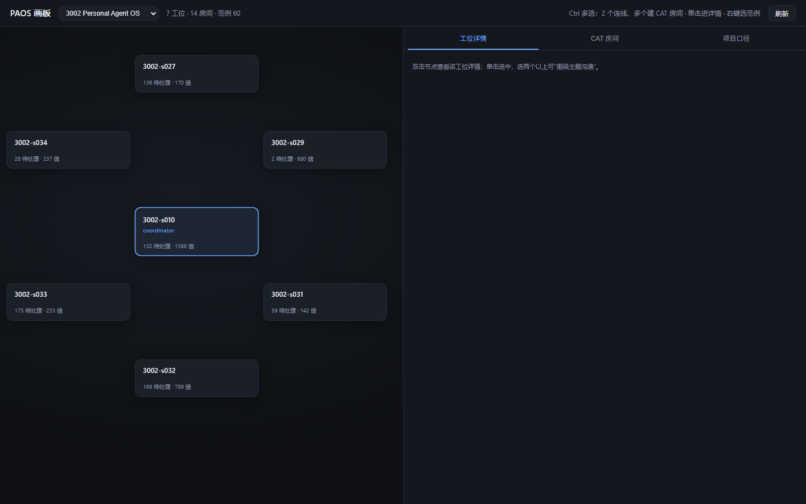

# PAOS

> **给 Agent 一份不会随对话消失的工作。**

大多数多 Agent 框架关心的是"**让几个 Agent 协作把活干完**"。
PAOS 关心的是另一件事：**对话关了、模型换了、电脑重启了，那份工作还在不在。**

PAOS（Personal Agent OS）是一个跑在你自己电脑上的**状态内核**：
它把跨会话的工作事实——项目、工位、当前责任、消息、决策、证据——保存成 JSON 和 Markdown，
让 Agent 可以被替换、暂停、接力、唤醒，而**工作本身一直连续**。

## 它跟别的多 Agent 系统有什么不同

| 维度 | 常见多 Agent 框架 | PAOS |
| --- | --- | --- |
| 关注点 | Agent 怎么协作干活（对话、编排、角色分工） | **工作怎么活过对话、活过运行时更换** |
| 状态在哪 | 内存、数据库、某个服务的会话里 | **你电脑上的 JSON / Markdown 文件**，人和 Agent 都能直接读改 |
| Runtime | 通常绑定某个模型或框架 | **可换**：Codex、OpenCode、Claude…换 Runtime，工位与责任不变 |
| Agent 是什么 | 一次性的任务执行者 | **长期员工**：固定工位、持续责任、可被唤醒接续 |
| 部署形态 | 给开发者用的库或平台 | **本机单用户**，Python 标准库，无重型依赖 |
| 前端 | 需要专门的服务与界面 | **一张画板**（节点 + 连线），直接反映工位与联系表 |

一句话：**别的框架让 Agent 更像一个团队，PAOS 让工作更像一份资产。**

## 为什么这件事值得做

多 Agent 协作最容易出问题的不是"Agent 不够聪明"，而是**状态断裂**：

- 派了一个活，Agent 干到一半，对话关了——下次它不记得自己是谁、在做什么。
- 换了个 Runtime，之前的任务上下文、责任边界全没了。
- 消息"发出去了"，但没人真正消费——你却以为已经交接完成。

PAOS 把这些问题拆成几件可验证的事：**留信（Mail）→ 登记（Notice）→ 唤醒（Wake）→ 消费（Handle）→ 归档**。
每一步独立成立，**"发出去了"永远不等于"做完了"**。

## 核心概念

**硬基座 · 项目事实与工作流**
项目资料按库组织（可复用的方法、流程、工具目录），稳定、可迁移。

**软约束 · 工位与协作**
每个长期 Agent 有一个固定工位（`Workstations/<agent>/`）：
`ENTRY.md`（身份入口）、`TODO.md`（当前责任）、`mailbox/`（持久消息）、`notices/`（待读与处理记录）。
**这些是 Markdown，你可以直接打开改**，不需要经过 PAOS 的工具。

**Runtime 可换**
Agent 的思考与执行交给 Codex / OpenCode 等 Harness；PAOS 只保存能活过它们的状态。
换会话、换模型、换电脑，**工位和责任不丢**。

**唤醒与接续**
原生会话可以关，Agent 可以离线。需要时通过 wake binding 把它叫醒，
它从自己的 ENTRY / TODO 恢复身份与当前责任，接着干。

**CAT 圆桌**
Agent 之间（以及人和 Agent）围绕主题的临时讨论空间。
讨论是自由的，但只有显式登记的结论才进入项目正式事实——**CAT 可以自由，PAOS 必须清楚。**

## 画板前端

一个轻量网页画板（原生 JS + SVG，无框架）：

- 以 **TEAM.md（联系表）**渲染工位节点：角色、职责、待处理、邮件数。
- **Ctrl 多选**：选 2 个画简单连线，选多个建 CAT 房间。
- **右键节点**：从 workflow / skill / tool 库里选范例，提示该 Agent 按范例参考。
- 点进工位看 TODO 全文、邮件、成果；点进 CAT 房间看完整对话、发言。
- **项目口径**直接展示项目库的 `INDEX.md`（唯一映射指南）。



## 快速开始

克隆本仓库后，在仓库根目录（Python 3.10+）：

```bash
# 查看将生成的配置（只读，不写文件）
python portable.py plan

# 生成本机安装配置（config/local/），并建好必要空目录
python portable.py init

# 只读核对配置与路径是否一致
python portable.py doctor
```

`init` 不覆盖已有配置、不导入项目、不创建工位、不启动服务；`doctor` 只读检查，**配置通过 ≠ 业务/唤醒已验证**。

然后按你的系统设置环境变量，验证 CLI：

```powershell
# Windows PowerShell
$env:PAOS_INSTALLATION_FILE = (Resolve-Path .\config\local\installation.json).Path
$env:PAOS_LIBRARY_ROOTS_CONFIG = (Resolve-Path .\config\local\library-roots.json).Path
$env:PYTHONIOENCODING = "utf-8"
python .\code\personal-agent-os\scripts\paos.py health
```

```sh
# Linux / WSL
export PAOS_INSTALLATION_FILE="$PWD/config/local/installation.json"
export PAOS_LIBRARY_ROOTS_CONFIG="$PWD/config/local/library-roots.json"
export PYTHONIOENCODING=utf-8
python code/personal-agent-os/scripts/paos.py health
```

**说明**：克隆本仓库得到的是**代码与共享方法资产**，不是某台电脑的已运行安装——项目、工位、登录态、接收器都需要在你自己的机器上另行准备或登记。

启动画板前端：

```bash
python front/paos_front_server.py --port 8780
# 浏览器打开 http://127.0.0.1:8780/
```

## 这套系统怎么组成

```
硬侧（代码，可重建）
  PAOS CLI + v3 核心模块 · CAT 圆桌引擎
软侧（Markdown，人与 Agent 共改）
  PAOS 库：workflow / skill / tool 方法资产
  项目库：工位 + INDEX + TEAM + 材料与成果
运行状态（机器读写）
  data/（registry、当前状态） + config/（安装配置）
```

一句话：**硬侧给机器，软侧给人；代码管"能跑"，库管"怎么跑"，项目库管"在跑什么"。**

## 它站在哪些项目的肩膀上

PAOS 借鉴但不复制：

- **AutoGen / CrewAI** 的多 Agent 消息协作 → CAT 圆桌，但 PAOS 把"讨论"与"正式事实"分开。
- **LangGraph** 的状态思想 → 但 PAOS 更轻，不强制图结构，用文件合同代替编排。
- **MetaGPT** 的角色 SOP → workflow 库，但 PAOS 是"软约束"（方法与范例），不是强制流程。

最大的不同仍是：**那些框架优化"怎么让 Agent 干活"，PAOS 在意"工作本身能不能持续、可迁移、被人看懂"。**

## 适合谁

- 你在用多个 Agent（Codex / OpenCode / Claude 等）做**长期、有连续性的事**，而不是一次性问答。
- 你希望**工作状态不寄生在某段对话、某个模型、某次运行上**。
- 你偏好**轻量、可读、可自己掌控**的本机工具，而不是又一个重型平台。

## 当前状态

PAOS-portable 是从一个真实使用中的 PAOS 系统**抽离、收敛出的可迁移单元**：
代码与业务资料分离、数据根从代码里抽出、历史依赖与可重建物剔除。
画板前端可运行；后端为 Python 标准库；工位与库为 Markdown / JSON。

它不是一个"功能大而全"的框架，而是一个**正在持续收敛、追求简单与可解释**的个人工作内核。
