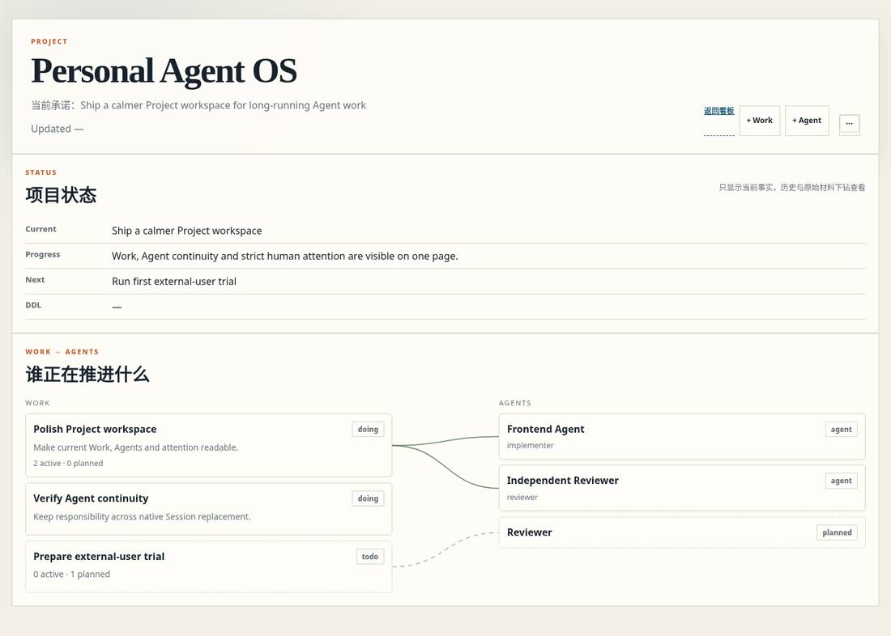
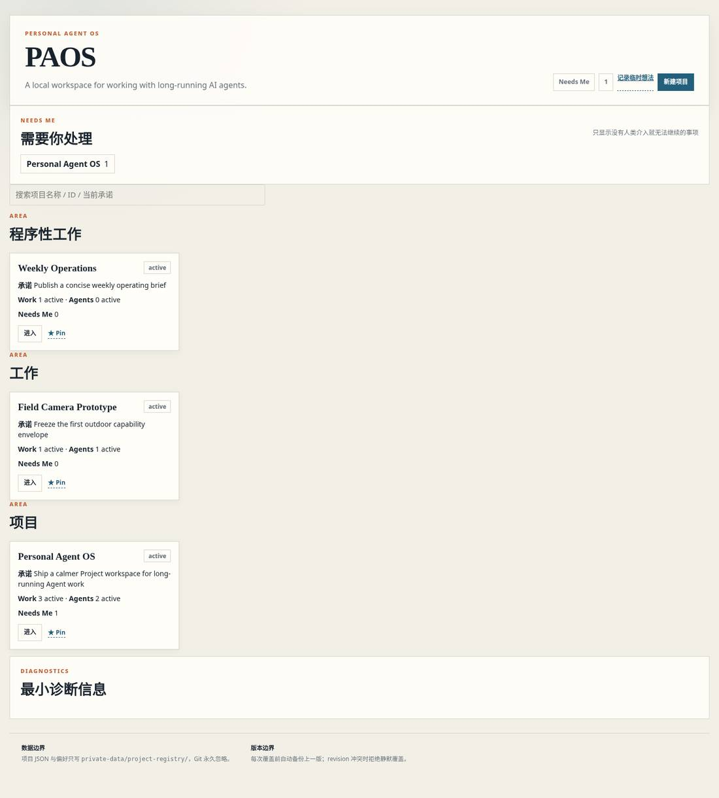
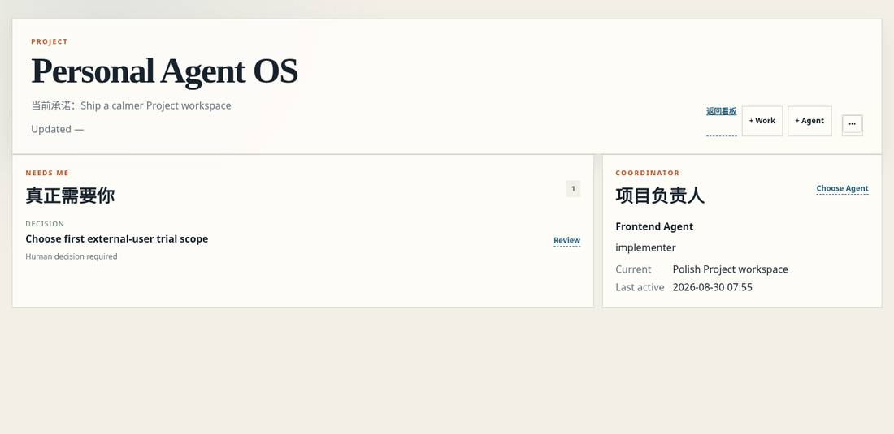
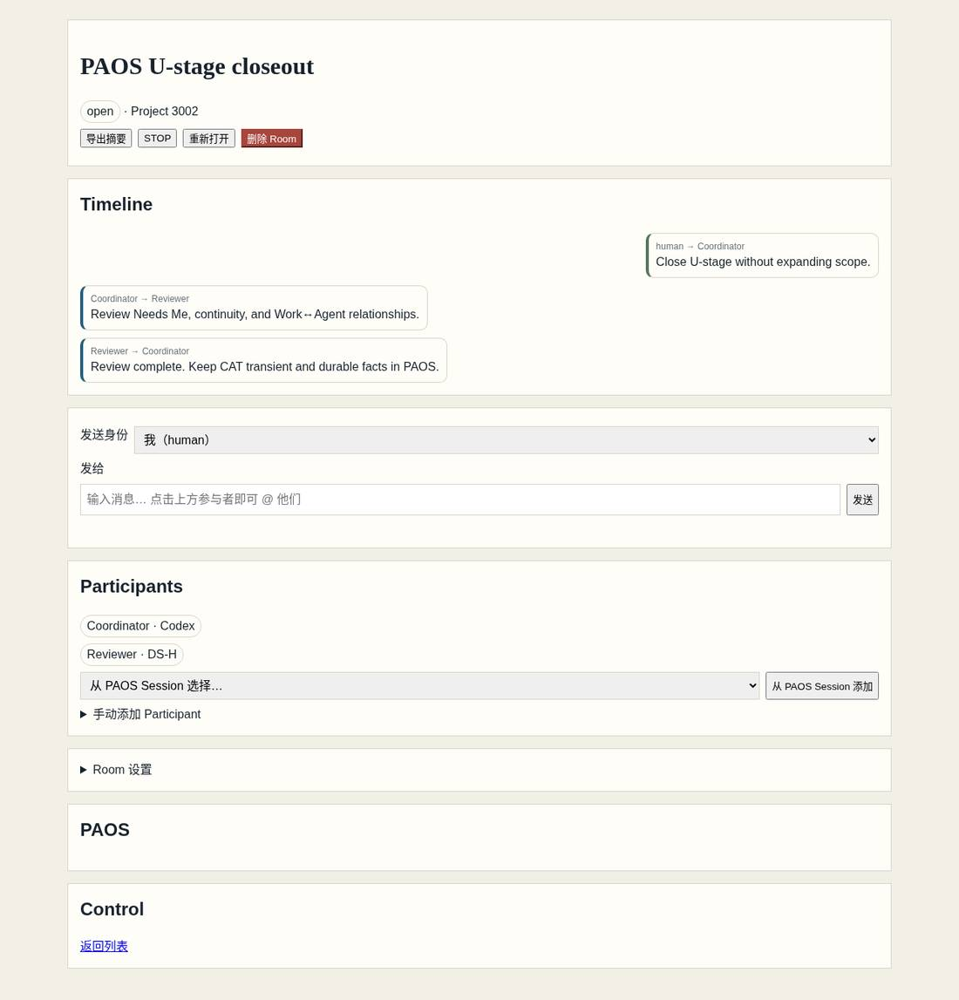

# PAOS

**A local operating system for working with long-running AI agents.**

Agent sessions end. Your work should not.

PAOS keeps durable work facts — Projects, fixed Agent Homes, Current responsibilities, decisions, requests, Mail/Notice evidence and handoffs — outside any single chat or model. You can change runtimes, models and native sessions without rebuilding the entire working state from memory.

PAOS is local-first, single-user and intentionally small. It does **not** replace the native Agent runtime. Codex, Claude Code, DeepSeek Harness and other runtimes do the actual reasoning and execution; PAOS keeps the work state that should survive them.

> Installed baseline: V1.3 is deployed and its authorized business scope is accepted. See [V1.3 release facts](docs/V1.3-RELEASE-FACTS.md) for acceptance evidence and retained Runtime exceptions. Read `paos health` for the running Source and the installation's release manifest for current adoption status. [`docs/V1.2-BASELINE.md`](docs/V1.2-BASELINE.md) remains historical V1.2 acceptance evidence.



*Screenshots use synthetic example data. Real `private-data/` is not committed.*

## What PAOS gives you

- **Durable Projects** — Project files and Git keep the case record; Agents keep operating across runs.
- **Fixed Agent Homes** — each Agent keeps a stable `Workstations/<agent>/` Home (ENTRY + current TODO + mailbox + notices); the same durable Agent continues across native runtimes and sessions.
- **需要我处理 / Needs Me** — only items that genuinely require human judgment.
- **Coordinator** — one Project-level Agent coordinates business meaning and directs Requests (no Work lifecycle units).
- **Evidence and recovery** — revision checks, receipts, backups and Restore protect durable facts.
- **Optional CAT sidecar** — temporary Agent-to-Agent collaboration stays separate from PAOS durable state.
- **Local JSON state** — no database is required for the reference implementation.

## Mental model

```text
Human
  |
  v
PAOS                     durable work facts
Project <-> fixed Agent Homes <-> native sessions
  |
  +---- Needs Me          real human decisions/blockers
  |
  +---- Coordinator       project-level planning and closure
  |
  +---- CAT               optional transient collaboration

Native Agent Runtime      reasoning, tools and execution
```

```text
PAOS    = durable work facts
CAT     = transient collaboration
Runtime = actual work
```

CAT may be offline without blocking the normal PAOS workflow.

## Screenshots

**Home — Projects and human attention**



**Needs Me + Project Coordinator**



**CAT Room — optional collaboration sidecar**



## Quick start

### Windows

Clone the repository and run from the repository root:

```powershell
.\scripts\start.ps1
```

PAOS opens:

```text
http://127.0.0.1:8766/attention-dashboard-v1-static/projects.html
```

If PowerShell execution policy blocks the script:

```powershell
powershell -ExecutionPolicy Bypass -File .\scripts\start.ps1
```

Run Doctor from the checkout you intend to use when startup or version identity is unclear:

```powershell
.\scripts\doctor.ps1
```

For WSL2 access, see [`docs/WSL-ACCESS.md`](docs/WSL-ACCESS.md).

### Developer/manual Python path

```bash
python attention-dashboard-v1-static/paos_server.py --port 8766
```

This is a development path, not a release-support claim for every OS. Native macOS and Linux releases are not currently claimed.

## First real workflow

```text
Create Project
  -> 登记 Agent（固定工位）+ entry Prompt
  -> paste the Prompt into the native Agent runtime
  -> Agent reads its Home (ENTRY/TODO), keeps its Current, works and hands off
  -> return to PAOS to review results and anything that needs you
```

**Manual copy/paste is a first-class mode.** Hooks, CAT and automatic Runtime wake are optional integrations, not prerequisites.

Start with one real Project. Do not configure every advanced feature first.

Guided first run: [`docs/START-HERE.md`](docs/START-HERE.md).

## The durable unit is the fixed House, not a Work object

A native Agent Session is an execution container that can end at any moment. A fixed Agent Home (`Workstations/<agent>/`) is the durable surface: `ENTRY.md` + current TODO (schema `paos-todo/v3`) + mailbox + notices.

```text
one session ended != the Agent stopped
```

Several Agents can share one Project. One durable Agent can continue across multiple native sessions. Completion lives in the Carrier Home's own Current and in review receipts — not in a Work status field. Members' fixed Homes and current responsibilities remain untouched; "one delivery is done" never implies "everyone went offline".

## How agents actually keep working

Two durable surfaces do the continuity work:

- **Fixed workstation** (`Workstations/<agent>/`): `ENTRY.md` + a trusted current block in `TODO.md` (schema `paos-todo/v3`, stable Home identity). NOTEs record durable input handling separately from personal duties. Identity, responsibility and the next executable step survive runtimes, models and native sessions; the Agent recovers from its stable Home and current inputs, not from chat history.
- **Durable Mail**: `paos mail send` only persists a message into recipients' workstations; `paos agent send` / `paos agent notify` additionally request one **native injection** reminder afterwards (`paos wake trigger`, one-shot: success stops there, failures are surfaced honestly). Mail stays a durable fact regardless of whether injection succeeds.

Four words are not interchangeable — verify each against its own evidence before trusting a pipeline story:

| word | means | evidence |
| --- | --- | --- |
| delivered | mail file entered the recipient's mailbox | mailbox file + dispatch JSON (sha256; same message id with different content is rejected) |
| woken / triggering / uncertain | contact native-target result of the one-shot injection | per-Home native-target state / injection receipt (no attempt files) |
| consumed | the recipient's own native session actually read and processed it | the recipient's native session/tool records |
| accepted | review/收口 accepted by the project's accounting paths | Current/审阅 receipt at the responsible Home |

Optional **contact native-target** bindings attach a fixed agent to one exact native session (OpenCode server HTTP). Codex Desktop is a locally-run application and has **no** external shell attach: wake from a WSL caller fails because the native Desktop caller credentials (`CODEX_APP_TOOLS_PIPE_PATH`, `CODEX_THREAD_ID`) are missing — running Windows Python does not supply them; a proposed thin host-side entry is **not an existing feature** (diagnosed in r052). Navigation to a bound thread is a separate manual/tool action, not wake. Wake never re-specifies the model — sessions keep their own selection. Runtimes are replaceable: binding, not identity, carries the native session id; offline or unavailable runtimes are shown as such, never faked as online (contact surface lives in `paos team` / `GET /api/projects/{id}/team`).

See [`docs/OPERATING-DETAIL.md`](docs/OPERATING-DETAIL.md) for the installed CLI surface, real relay chains (including an honest interrupted-then-repaired sample) and frontend interface mapping.

## Needs Me

PAOS does not turn every warning, request or blocked item into a human notification.

> **Needs Me = without human intervention, the current work cannot continue correctly.**

If an Agent or Coordinator can resolve it, it should remain out of Needs Me.

## CAT is optional

CAT lives in the separate `co-agent-2` repository and provides transient Agent-to-Agent collaboration.

- PAOS works without CAT.
- CAT is not the durable Project fact source.
- PAOS does not import CAT or manage its process.
- Runtime integrations have their own support and recovery boundaries; see [`docs/SUPPORT-MATRIX.md`](docs/SUPPORT-MATRIX.md).

## Reliability boundary

Durable writes follow the PAOS Store path rather than ad-hoc file edits:

```text
read -> validate -> idempotency -> revision check
     -> apply -> validate -> revision++
     -> Ledger / receipt -> backup -> atomic replace
```

Typical failure behavior:

- stale revision -> explicit conflict instead of silent overwrite;
- duplicate operation -> idempotent result or explicit conflict;
- Project Restore -> current state is backed up first and revision stays monotonic;
- missing or invalid Context Pack -> visible error instead of fabricated reconstruction.

Architecture and recovery details:

- [`docs/ARCHITECTURE.md`](docs/ARCHITECTURE.md)
- [`docs/PRODUCT-AND-DESIGN-PHILOSOPHY.md`](docs/PRODUCT-AND-DESIGN-PHILOSOPHY.md)
- [`RECOVERY.md`](RECOVERY.md)
- [`SECURITY-BOUNDARIES.md`](SECURITY-BOUNDARIES.md)

## Verify the repository

Python is required for PAOS. Node is used by the JavaScript test suite.

```powershell
.\scripts\verify.ps1
```

or:

```bash
python scripts/verify.py
```

Release-boundary check:

```bash
python scripts/release_check.py
```

The release check only verifies the source-package boundary: tracked `private-data`, runtime output and secret-style files must not enter the release tree. It does not scan or upload ignored local user data.

## Documentation map

**Use the product**

- [`docs/START-HERE.md`](docs/START-HERE.md) — first real Project
- [`docs/SESSION-CONTINUITY.md`](docs/SESSION-CONTINUITY.md) — historical Employee identity chain reference (Session→Session `continues_session_id`); **not** the normal handover login path — normal resume is fixed workstation ENTRY/TODO + `paos orient`, with current operating guides located from ENTRY.
- [`docs/OPERATING-DETAIL.md`](docs/OPERATING-DETAIL.md) — installed CLI/API surface, business chains, Runtime/contact-native-target/Mail/CAT boundaries, frontend interface map
- [`docs/NEEDS-ME.md`](docs/NEEDS-ME.md) — strict human-attention projection
- [`docs/COORDINATOR.md`](docs/COORDINATOR.md) — Project-level Coordinator (business meaning, Requests; no Work lifecycle)
- [`RECOVERY.md`](RECOVERY.md) — recovery entry

**Understand or change the system**

- [`AGENTS.md`](AGENTS.md) — canonical development-Agent entry
- [`docs/CODE-MAP.md`](docs/CODE-MAP.md) — where to change code
- [`docs/DOMAIN-MODEL.md`](docs/DOMAIN-MODEL.md) — Project / fixed Agent Home / Session semantics (Workless)
- [`docs/THREE-LAYER-MODEL.md`](docs/THREE-LAYER-MODEL.md) — PAOS / CAT / Runtime boundary
- [`docs/DEVELOPMENT-PRINCIPLES.md`](docs/DEVELOPMENT-PRINCIPLES.md) — implementation principles
- [`docs/SUPPORT-MATRIX.md`](docs/SUPPORT-MATRIX.md) — release support boundary

Historical development notes are archived behind [`VERSION_HISTORY.md`](VERSION_HISTORY.md); they do not define current behavior.

## Security boundary

The reference implementation is for one person on one machine:

1. PAOS binds to localhost by default;
2. `private-data/`, credentials and real project material stay out of Git;
3. Agent writes go through narrow APIs and durable-write contracts;
4. PAOS does not automatically start arbitrary external Agents;
5. CAT is process- and data-isolated from PAOS.

This is not an enterprise multi-user authorization system.
