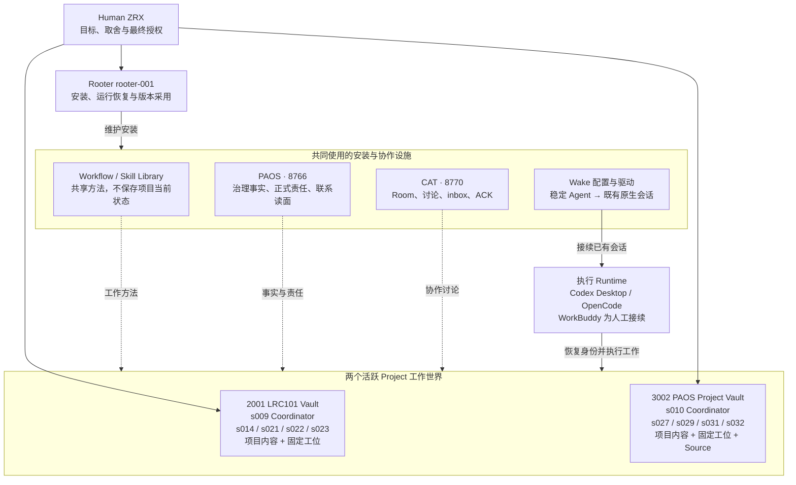
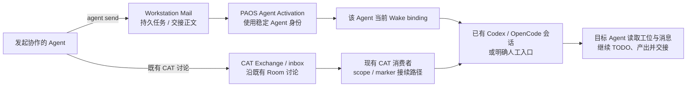

# PAOS 现版本组织与组件总览

核对日期：2026-10-02，Asia/Shanghai。本文描述当前安装和工作入口；实时责任与联系状态仍从 PAOS 读取。

当前 PAOS 是一套围绕长期 Project 和长期 Agent 运转的本地工作系统：两座 Project Vault 保存项目内容，固定工位保存员工的接续入口，共享方法库提供工作方法；PAOS 维护治理事实，CAT 承载讨论，Wake 把持久消息接到已经存在的 Runtime。Rooter 维护安装，项目 Coordinator 负责业务推进。

## 1. 组织与组件关系



图中的公共设施是能力关系，不是员工上下级。Rooter 不代替 s009/s010 决定项目内容，也不代员工 Ack、规划或验收业务成果。CAT 中的历史 Participant 不等于当前团队成员。

### 两座 Project Vault

| Project | 正常工作位置 | 当前团队 |
| --- | --- | --- |
| 2001 LRC101 | `C:\Users\remo\Desktop\OBSBOT-Projects\2001-LRC101` | s009：产品主线与 Coordinator；s014：主稿编辑 / Human 对接；s021：实施；s022：实施 / 独立复核；s023：实施 / 待机值守 |
| 3002 Personal Agent OS | `C:\Users\remo\Desktop\agent学习计划\PAOS-Projects\3002-Personal-Agent-OS` | s010：Coordinator / 集成；s027：主实施 / 连续性 / CLI；s029：独立复核；s031：Codex Runtime 专项；s032：运行问题支持 |

两座库都有 `INDEX.md / Inbox / Materials / Works / Decisions / Workstations / Archive`。3002 另外有 `Source/personal-agent-os/`，用于代码、测试和与实现绑定的技术文档。

固定工位是 `<Project root>/Workstations/<agent-id>/`，包含 `ENTRY.md、TODO.md、mailbox/`。工位跟随长期 Agent，不随 Work 或原生会话重建。项目成果进入 Project 的 Works / Materials / Decisions，不只留在聊天或工位上。

当前 registry 中仅 2001、3002 为 active；另外八个 Project 为 closed，历史文件和治理记录保留。closed 不代表删除，TEAM 在队也不代表员工此刻正在生成。

## 2. 各层保存什么

| 组件 | 当前位置或入口 | 职责 |
| --- | --- | --- |
| Project 内容 | 两座 Vault 的 Works / Materials / Decisions | 正文、输入材料、评审、交接、项目决策 |
| Project 团队 | 两座 Vault 的 `TEAM.md` | 稳定岗位、工位与联系方式；不手抄实时在线状态 |
| Workflow Library | `C:\Users\remo\Desktop\agent学习计划\PAOS-Libraries\workflow` | 工作循环、操作指南、接续与采用规则、模板 |
| Skill Library | `C:\Users\remo\Desktop\agent学习计划\PAOS-Libraries\skill` | 按任务需要使用的专业执行方法 |
| PAOS API / 页面 | `http://127.0.0.1:8766` | Project / Work / Session / Request / Decision / Artifact、revision、Ledger 与 receipts |
| PAOS 源码 | `3002-Personal-Agent-OS\Source\personal-agent-os` | PAOS 应用的版本化代码，不是另一座 Project Vault |
| PAOS Store | 上述 Source 内的 `private-data\project-registry` 等 | installation-local 治理状态；当前 private-data 为真实目录，不是旧 root Junction |
| CAT | `http://127.0.0.1:8770`；源码 `C:\Users\remo\Desktop\agent学习计划\co-agent-2` | 两个现有 Room 的持久 Exchange、inbox、ACK、消费者接续 |
| CAT 运行状态 | CAT 源码树内 `private-data\rooms\<room-id>\runtime\<participant>` | scope / marker / 消费者状态，不能替代业务完成证据 |
| 安装描述 | `C:\Users\remo\.paos\installation.json` | Windows / WSL 共用的 Source 与 Library 配置定位 |
| Library roots registry | `C:\Users\remo\.paos\library-roots.json` | 两座共享方法库的唯一安装登记 |
| Rooter Home | `C:\Users\remo\Desktop\agent学习计划\PAOS-Rooter\rooter-001` | 安装 TODO、报告、恢复点与安装交接；不是某个 Project 的 Coordinator 工位 |

旧 `personal-agent-os` root、FM / workspace-M 和旧 Cycle 目录仍可保存历史证据；它们不再是两座活跃 Project 的正常成果写入位置。Artifact 可以指向诚实的历史或外部证据，不要求所有 Vault 文件都登记 Artifact。

### 当前共享方法基线

Workflow Catalog 为 15 项：2 个工作循环、6 份 Guide、7 份 Template。

- `wf-agent-work-cycle`：长期 Agent 自主恢复、推进、交接。
- `wf-coordinator-governance-cycle`：Coordinator 分派、整合、解决真实阻碍并收口。
- Guides：PAOS/CAT 操作、Project 文件与 Git、Runtime 接班、升级采用、安装发布、Rooter 安装维护。
- Templates：ENTRY、TODO v2、TEAM、Project AGENTS、公告、发布说明、采用结果。

Skill Catalog 仍只有 3 个 canonical Skill：`skill-engineering-change`、`skill-independent-review`、`clean-writing`。本机 Codex 的其它 Skill 包不因存在就成为共享基线。`clean-writing` 用于面向读者的成果呈现，不用于约束执行者的工作过程。

源 Markdown 是方法权威；Catalog 是生成索引，usage event 是使用记录。Project 正文和当前工作状态不塞进 Library。

## 3. 消息与唤醒的实际路径



`mail send/reply` 只落信；需要下一位接续时用 `agent send`，已有同一封 Mail 用 `agent notify --mail`。业务目标是稳定 Agent，Runtime 只是当前执行载体。

现有两个 CAT Room 都是 open / event：3002 对应 `room-e7f0cfaa5c5f`，2001 对应 `room-f96fc33111b9`。本轮 Room API 没有返回 `activation_owner` 字段，当前仍保留 scope / marker 消费者路径；不能把历史 Agent-first 设计说明当成“现有 Room 全部已由 PAOS 接管唤醒”的安装事实。

Wake 不自动创建原生会话，也不为了联系员工自行启动 Harness；离线、不可达、人工入口应在联系面明确显示。OpenCode 自动调用沿用当前会话模型，除非 Human 显式要求，不换模型。

一条协作链要分别看：消息持久落盘、激活结果、本人读取、实际成果、接受。送达、ACK、online 或 `woken` 不能互相替代。普通 `team/peers/status` 的状态带有检查时间；最后一次 probe 不是永久在线证明。

### 当前 Wake 配置

每个 Agent 的绑定保存在自己的 Project：`.paos/wakeup/bindings/<agent-id>.json`；controller 的 state / attempts 也在 Project `.paos/wakeup/`。原生执行状态统一登记到 `C:\Users\remo\.paos\wakeup-native\codex` 或 `...\opencode`。这些是运行状态，不是 Project 正文。

| Agent | Runtime / driver | 当前绑定目标 |
| --- | --- | --- |
| 3002-s010 | Codex Desktop / codex | `01a042ee-4ac4-7613-8619-3782fc03554f` |
| 3002-s027 | OpenCode / opencode | 4102 · `ses_f22099a35ffeZNS78Cq72m3KUF` |
| 3002-s029 | OpenCode / opencode | 4101 · `ses_f12d21b5fffe8z3nExCw6s2pw8` |
| 3002-s031 | Codex Desktop / codex | `01a0b95c-c097-7f90-b0dc-f2a3bce41fc5` |
| 3002-s032 | OpenCode / opencode | 4123 · `ses_f0ed7064dffeYeFh5dohmTLkgz` |
| 2001-s009 | Codex Desktop / codex | `019feeba-39f6-7831-a71d-d87de43a9994` |
| 2001-s014 | WorkBuddy / manual | 工位 Mail + 人工继续，无自动原生 Wake |
| 2001-s021 | OpenCode / opencode | 4110 · `ses_f626c2e58ffefiGeX5e06SUnfJ` |
| 2001-s022 | OpenCode / opencode | 4111 · `ses_f626a5b81ffek740zZpH3H2evo` |
| 2001-s023 | OpenCode / opencode | 4112 · `ses_f62698f16ffeCkcgbOH8X3Yxm3` |

OpenCode 端口均绑定 `http://127.0.0.1:<port>`。例如在 Windows 展示 s027 的既有会话：

```powershell
wsl --exec /home/remo/.opencode/bin/opencode attach http://127.0.0.1:4102 --session ses_f22099a35ffeZNS78Cq72m3KUF
```

Codex 在桌面端打开绑定 Thread，不编造 shell attach 命令。Codex driver 复用的 transport checkout 是 `C:\Users\remo\Desktop\agent学习计划\co-agent-2-wake-app-tools-8f2`，它不是第二个 CAT 服务。

配置由接入者 / Rooter 维护；其他 Agent 使用联系面，不手工修改同事 binding、清 STOP 或重放历史未决 attempt。Scope 的 consumer fence 属于运行接续边界，不是项目 Coordinator 任期。

## 4. 日常入口

Windows 使用 `C:\Users\remo\.paos\bin\paos.cmd`；WSL 使用 `/home/remo/.local/bin/paos`。两边读取同一份 Windows 安装描述，WSL locator 为 `/mnt/c/Users/remo/.paos/installation.json`。

```powershell
& 'C:\Users\remo\.paos\bin\paos.cmd' orient 3002 3002-s010
& 'C:\Users\remo\.paos\bin\paos.cmd' team 3002 3002-s010
& 'C:\Users\remo\.paos\bin\paos.cmd' inbox 3002 3002-s010
& 'C:\Users\remo\.paos\bin\paos.cmd' status 3002 3002-s010
```

把示例身份换为本人。`orient` 恢复当前责任；`team/peers` 找同事与已有会话入口；`inbox` 分开读取 Mail、正式 Request 和已配置 CAT；`status` 看联系与交付证据。忘记参数看同版 `--help`，不从旧会话猜命令。

新 Agent 从固定 ENTRY → TODO 当前区 → `orient` 继续已有责任。方法按需取自 Library；成果写回 Project。不要因收件箱为空停止未完成主线，也不要把换原生会话变成重新创建长期员工。

## 5. 当前项目状态与待收口项

| 项目 | 本轮实读结果 |
| --- | --- |
| PAOS 运行 / Source HEAD | `de27c07cb80c09e6066ae8cd6d9204aca58b7f91`，V1.2 + PR115/116 窄修已在运行服务 |
| 共享 Library HEAD | `ed32316df77b59867fdc43d1a3b154be34da4e66`，roots已登记，发布指南对齐de27；最新仅补直接验收命令，Catalog 15 Workflow项 / 3 Skill |
| CAT 源码 HEAD | `5fa04ffe1f5cb061f9c9c07176435d3c9d711bf6` |
| Codex transport checkout HEAD | `690e02ca3530bb70068452435d550010c4dfe7c9`；此行为 checkout 版本，不冒充 CAT 运行 build identity |
| Project 2001 | active；独立 LRC101 Vault；最终实读 revision 1214，s009 已消费最终安装回流 |
| Project 3002 | active；独立Project Vault + Source；w060验收revision804，当前总览摘要回执807 |
| 当前 3002 主线 | s010正式责任仍在w007；V1.2 Stage2/Stage3及w060已验收done，成员任期与Work验收分开 |

本轮总览已进入Project 3002主要文件。w060正式验收回执为`op-s010-w060-stage3-accept-20261002`（revision804）；当前生成摘要回执为`up-s010-stage3-accepted-confirmed-20261002`（807）。Rooter已确认验收，s027/s029/s031已实际消费完成通知并清掉个人当前页旧等待。原Human承诺、Project root及成员任期不变。

当前仍需区分三件事：

- PR116安装采用及w060验收均已完成：Windows/WSL公共health同de27，六绑定指向同一实际目录、已有样本字节一致。当前不再等待部署、成员Session关闭或重复门禁。
- s014 是 WorkBuddy 人工接续例外；绑定列表不能写成十人全部自动唤醒。
- 联系面仍显示历史在途 / uncertain attempts；保留已消费和成果证据，不因历史状态盲目重放。旧 doing / review Work 也不能据此当成当前有员工正在执行。

组件整理没有更改Rooter、Wake、Room、模型或Project root；既有已授权V1.2主线的w060验收独立使用正式Coordinator入口完成，不以整理文档冒充治理mutation。

### 核对来源

- 已安装 CLI：`health`、`install show`、`library roots show`、`team`、`wake status`、`inbox`。
- PAOS live：`GET /api/projects`、`GET /api/projects/3002`；仅两个 Project active。
- 两座 Project 的 TEAM、固定工位与 `.paos/wakeup/bindings/`。
- Workflow / Skill 的源文件、CATALOG，以及 Library 当前 Git HEAD。
- 两个 CAT Room / inbox 的真实 HTTP 返回；CAT scope；PAOS Windows 服务与 WSL 接入 bridge。
- Rooter 的安装报告用于交叉检查；有冲突时以本轮 live / 磁盘实读为当前状态，不继承旧报告的版本号。
- 结束前收到并读取 `rooter-stage3-de27-final-return-20261002`；已核其共享状态实证 `PAOS-Rooter/rooter-001/reports/V12-STAGE3-DE27-SHARED-STATE-PROOF-20261002.json`，六绑定逐项均为 true。本轮不新增原生回合、并发实验或业务重放。
