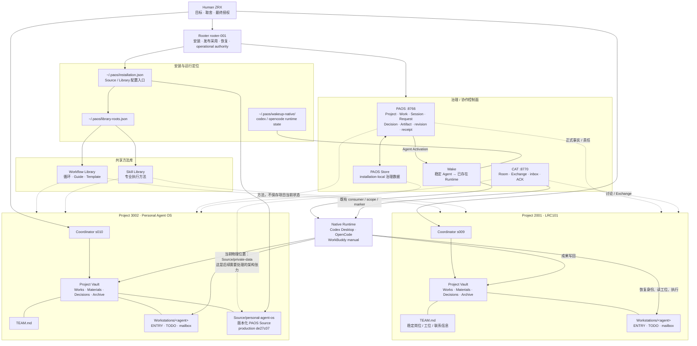

# 网页 GPT 架构审查原文

来源会话：6abf5e0f-72fc-83ea-9660-c43c56b71573；回复：8e882934-9ab2-40f1-9236-6a6496a0e2a0。以下为网页模型建议，尚未等同本地代码事实或开发授权。

Rooter 的最新校准已纳入。以下把两份全文、最终证据包以及本回合 GitHub 只读实读合成一份**评审视角的全景**；Stage 3 作为已完成事实保持关闭，后面的内容是 V1.2 之后的架构债与产品演进建议，不是追加验收条件。

:::writing{variant="document" id="58341" title="PAOS Stage 3 后总体架构评审"}
# PAOS Stage 3 后总体架构评审

## 0. 事实基线与材料优先级

本评审使用四类材料：

- **[组件图]** `PAOS-COMPONENT-MAP-2026-10-02.md`
- **[采用报告]** `V12-STAGE3-ADOPTION-RESULT-20261001.md`
- **[最终证据包]** `docs/planning/PAOS-V12-STAGE3-LIVE-CUTOVER-20261001/README.md` 及其中只读证据
- **[GitHub 当前实读]** 本回合直接读取 PR111/112/113/116 当前状态

发生冲突时，采用“当前 live / 最终证据 > 后续校准 > 历史过程段”的原则。

因此当前基线已经可以固定为：

| 项目 | 当前事实 |
|---|---|
| Stage 3 | **已完成，不重开** |
| `3002-w060` | `done`；operation `op-s010-w060-stage3-accept-20261002`；event `3002-e784`；revision `803→804` |
| Production Source | `de27c07cb80c09e6066ae8cd6d9204aca58b7f91` |
| Shared Library | `ed32316df77b59867fdc43d1a3b154be34da4e66`；旧 `fc619874` 已过时 |
| PR116 | 已合并、已实际运行；Windows/WSL 已读到共同状态路径 |
| PR111/112/113 | **CLOSED，未合并，superseded/未采用旧候选**；其中 PR112 的 instance/write-owner 路线不能声称被原样吸收 |
| 活跃 Project | 仅 2001、3002 |
| s014 | WorkBuddy/manual 例外，由 s009 持有，不阻塞 Stage 3 |
| 历史 inflight / uncertain attempt | 保存证据，**不盲目重放** |
| 3002 当前主线 | Stage 3 已结束，但 Project 本身未结束；s010 仍有既有 `w007` 责任 |

其中 `[采用报告]` 中“PR111/112/113 仍 OPEN”属于报告写作时的历史观察，已经被 Rooter 后续校准、最终证据包以及 GitHub 当前实读覆盖。

---

# 1. 我对 PAOS 的整体架构理解

PAOS 当前不是一个“自动运行所有 Agent 的超级 Agent”，而是一套围绕**长期 Agent、长期 Project、固定工位和可验证业务接续**构建的本地工作系统。

最重要的分层是：

| 层 | 核心职责 | 当前事实源 |
|---|---|---|
| Human | 目标、取舍、最终授权 | Human |
| Rooter | 安装、发布采用、运行恢复、跨 Project operational authority | Rooter Home + 安装读面 |
| Project | 长期业务世界 | 2001 / 3002 Project Vault |
| Coordinator | Project 内责任分派、产物接受、Work 收口 | PAOS + Project 文件 |
| Agent | 长期员工身份 | PAOS / TEAM / 固定 Workstation |
| Workstation | Agent 的稳定恢复入口 | `ENTRY.md / TODO.md / mailbox/` |
| PAOS | 治理事实、正式责任、Work/Session/Request/Decision/Artifact、revision/receipt | `:8766` + Store |
| CAT | 持久讨论、Room、Exchange/inbox/ACK | `:8770` |
| Wake | 稳定 Agent → 已存在 native Runtime 的激活桥 | Project binding + native wake state |
| Runtime | 真正执行一次次原生回合 | Codex Desktop / OpenCode / WorkBuddy |
| Workflow Library | 跨 Project 共享的工作过程和操作方法 | shared workflow root |
| Skill Library | 可复用专业执行方法 | shared skill root |
| Git / Artifact | 历史、代码、可审计证据 | Git / Project Works / Artifact |

关键原则是：

> **Agent 是长期角色；Runtime 是可替换执行载体；Project 是业务世界；Work 是正式责任；文件与 PAOS 保存连续性；Wake 只负责把已有 Runtime 接起来。**

这也解释了为什么 `Work done` 不等于 `Session close`，更不等于“员工离开团队”。

---

# 2. 全景图一：组织、事实与文件



### 这张图里最重要的“事实归属”

**PAOS Store** 保存治理事实；**Project Vault** 保存业务正文和成果；**Workstation** 保存某个长期 Agent 的稳定入口和局部执行上下文；**Library** 保存方法而不是项目状态；**CAT** 保存讨论；**Wake/native state** 保存激活运行状态；**Git/Artifact** 保存历史和证据。

目前最大的物理结构例外恰恰是：

> PAOS Store 虽然概念上是 installation-local durable state，但当前实际位于生产 Source checkout 的 `private-data` 下面。

这会在后文作为架构债单独讨论。

---

# 3. 全景图二：真实消息 → Runtime → 业务接续 → 接受

```mermaid
flowchart LR
    Sender["发起者 / Coordinator / Agent"]

    subgraph Formal["正式定向交接"]
        Mail["Workstation Mail<br/>持久正文"]
        Activation["PAOS Agent Activation<br/>稳定 Agent 身份"]
        Binding["Wake binding"]
    end

    subgraph Discussion["既有讨论链"]
        CAT["CAT Exchange / inbox"]
        Consumer["CAT consumer<br/>scope / marker"]
    end

    Native["已存在 Native Session<br/>Codex / OpenCode<br/>或明确 manual 入口"]

    Restore["读取 ENTRY + orient + inbox<br/>恢复正式责任与局部上下文"]
    Work["执行当前真实 Work<br/>TODO 仅承载局部执行信息"]
    Artifact["成果落 Project<br/>Works / Materials / Artifact"]
    Review["下游消费 / 独立复核"]
    Accept["Coordinator 接受"]
    Receipt["PAOS Work transition / receipt<br/>业务状态正式收口"]

    Sender -->|"agent send"| Mail
    Mail -->|"① persisted"| Activation
    Activation -->|"② activation attempt"| Binding
    Binding --> Native

    Sender -->|"CAT discussion"| CAT
    CAT --> Consumer
    Consumer --> Native

    Native -->|"③ 本人实际读取 / incorporated"| Restore
    Restore --> Work
    Work -->|"④ 真实产物"| Artifact
    Artifact --> Review
    Review --> Accept
    Accept -->|"⑤ accepted"| Receipt

    Queue["queued / running Wake attempt"]
    Binding --- Queue

    Observe["统一状态读面应同时看：<br/>persisted · activation · consumed · artifact · accepted"]
    Mail -.-> Observe
    Queue -.-> Observe
    Restore -.-> Observe
    Artifact -.-> Observe
    Receipt -.-> Observe

    Reminder["有界提醒"]
    Observe -. "仅在确无 queued/inflight<br/>且确实未消费时才考虑" .-> Reminder
```



这条链必须坚持五个不同事实：

**落信 ≠ 激活；激活 ≠ 本人读取；本人读取 ≠ 产物；产物 ≠ Coordinator 接受。**

Stage 3 最有价值的实证之一，就是已经真实走过：

> s027 产物 → s029 独审 → s010 接受 → `w060` 正式 transition。

同时，最终证据还记录过一次：原生回合结束约一秒后，已有 queued Wake 自动启动下一回合；Rooter 一度把“一个回合结束”误读成“停链”并多发提醒。这个例子说明今后的接续优化重点应该是**把现有事实看清楚**，而不是增加 heartbeat、scheduler 或无限 self-wake。

---

# 4. 当前架构最值得处理的具体缺口

## 4.1 P0：当前状态仍存在重复维护和派生漂移

### 已部署事实

V1.2 已经把正式 Work 状态放在 PAOS，把个人当前执行放在 TODO，并通过 `orient` 恢复责任；共享 TODO 模板也要求历史长记录进入 Works。

### 实际缺口

最终成员回读暴露了一个非常具体的矛盾：

- s027 / s029 的 `current_work.status` 已经是 `done`
- 本人 TODO 也已经明确写成 `w060 done / 待机`
- TODO `trusted=true`
- 但同一份责任读面里的派生 `next_action` 仍出现“继续当前 Work 3002-w060；TODO 当前区不可用”

这至少证明**某个当前读面仍可能把已经闭合的 Work、TODO 和 next_action 组合成不一致结果**。目前仅凭报告还不能判断是快照组装顺序、缓存，还是 `orient/status` 的真正派生 bug。

### 性质

**实现债，而且是当前最高优先级的软件债。**

### 建议方向

PAOS Work/责任事实应该拥有绝对优先级；TODO 不再重复保存 Work 的正式 status/done_when/version，而只保留：

> 本地下一步、临时 blocker、inflight、产物指针和必要工作笔记。

Work 关闭后不应该要求每个 Agent 通过“复制正式状态到 TODO”来维持系统正确性。TODO 可以校准可读性，但不能成为 Work 已完成之后仍让 `orient` 判断错误的第二事实源。

---

## 4.2 P0：业务接续证据完整，但观察面仍然割裂

### 已部署事实

PAOS 已经分别拥有：

- Mail persistence
- Wake attempt
- incorporated / handling marker
- Artifact / Project 文件
- Coordinator receipt / Work transition

因此底层并不缺“真实证据”。

### 实际缺口

这些证据分散在 Mail、Wake、CAT、Project 文件、PAOS Work 和各类 readback 中，人和 Agent 容易把其中某一个阶段误认为整条链完成。

Stage 3 中已经出现：

- `woken` 但不能证明消费；
- Wake uncertain 但真实产物已经形成；
- 单回合结束被误判为停链；
- 产物已经被下游接受，但旧 TODO 仍保留等待叙述。

### 性质

**实现债 / UX 债，不需要新治理模型。**

### 建议方向

增加一个**纯派生的 Handoff/Continuation Read Model**，只汇总已有事实：

`persisted → activation → consumed → artifact → accepted`

它不能成为新状态库，也不能创造新的“完成”语义。

正常情况下，人只需看到一行：

> s027 → s029 · consumed · artifact present · accepted by s010

而不是自己拼 Mail、Wake、CAT 和 TODO。

---

## 4.3 P1：PAOS / CAT / Wake 的职责在概念上已分开，但激活控制仍有重叠

### 已部署事实

当前材料给出的理想边界其实是合理的：

- **PAOS**：身份、责任、正式治理事实。
- **CAT**：Room、讨论、Exchange/inbox/ACK。
- **Wake**：把稳定 Agent 激活到已有 Native Session。

所以三者不是简单重复产品。

### 具体张力

当前实际存在两条通向 Native Session 的路径：

1. `PAOS Agent Activation → Wake binding → Native`
2. `CAT Exchange → consumer scope/marker → Native`

因此 CAT 不仅存讨论，它仍保留一部分消费者接续状态；而 PAOS 又拥有 Agent-first activation。

这造成真正的重叠不是“谁保存业务状态”，而是：

> **谁拥有 Agent 的 routing / activation / liveness 解释权。**

### 性质

当前可以继续运行；长期属于**产品边界决定 + 后续实现债**。

### 建议方向

长期更干净的目标应当是：

- PAOS：唯一稳定 Agent / contact / activation 控制入口；
- Wake：PAOS 背后的 effectful driver，不拥有业务语义；
- CAT：保留 Room、持久对话、讨论 inbox，不拥有“业务完成”或独立员工身份。

不建议现在为了架构洁癖删除 CAT 或 Wake。首先应该统一**观察面和 activation ownership**，再用真实业务证明是否值得迁移现有 CAT consumer。

---

## 4.4 P1：Store、生产 Source 与开发 checkout 的生命周期仍绑得太紧

这是当前架构最明显的物理边界问题。

### 已部署事实

现在已经有：

- `~/.paos/installation.json` 定位 Source；
- `~/.paos/library-roots.json` 定位共享 Library；
- Windows/WSL 共用安装描述；
- PAOS Store 是真实目录，不再是旧 root Junction。

这些都是正确方向。

### 但目前

生产 Source 指向：

`3002 Project Vault / Source / personal-agent-os`

而 installation-local Store 又在：

`Source/private-data/...`

最终证据甚至明确记录当前生产 checkout 还有一个既有 modified 文档。

因此现在实际把三种生命周期放在了一棵树里：

> **开发源码生命周期 + 生产安装生命周期 + durable governance data 生命周期。**

换 checkout、清理工作树、恢复代码、做 release worktree 时，都必须特别小心不要碰到 Store。

Shared Library 也出现一个较轻版本的同类问题：usage event 作为本机运行记录留在 Library working tree 的 `.paos/usage-events` 下，虽然没有提交，但会污染 canonical method checkout 的“干净性”。

### 性质

**明确实现债；最终目录/安装模型需要一次产品决定。**

### 更干净的目标

逻辑上至少应独立成：

`Project developer source`  
`Production installation source`  
`Durable PAOS data/store`  
`Shared method source`  
`Runtime usage/state`

安装描述负责把这些根连接起来，而不是依赖 checkout 的相对物理位置。

是否一定要把 production Source 复制成独立 immutable release tree，可以由产品决定；但**Store 不应因为 Source checkout 换位置而改变数据身份**，这是更基础的边界。

---

## 4.5 P1：Project summary / archive 缺少正常日常 CLI

这是证据包已经明确承认的产品债。

### 当前事实

Project 现状摘要写入和 archive 仍需已有窄 HTTP 合同；日常 CLI 没有完整覆盖。

### 性质

**纯实现/操作面债务，基本不需要重新设计 domain。**

### 建议方向

直接给现有 HTTP 合同补薄 CLI facade，并沿用同一权限、operation id、revision 与 receipt。

完成以后，“忘记命令”应该能通过同版 CLI `--help` 恢复，而不是让 Coordinator 回源码里找 HTTP endpoint。

---

## 4.6 P2：Workflow / Skill 已有正确雏形，但共享资产的治理职责还不够显式

### 已部署事实

现在的边界相当清楚：

- Workflow Library：工作循环、Guide、Template；
- Skill Library：专业任务方法；
- Markdown source 是方法权威；
- Catalog 是生成索引；
- usage event 是使用记录；
- Project 当前业务状态禁止塞进 Library。

这部分我认为**不应该重新设计成一个庞大的新能力系统**。

### 真正欠缺

材料对“谁消费”描述清楚，但对“谁拥有 canonical 内容、谁批准 promotion、各 Project 如何贡献回共享基线”没有形成同样明确的一句话责任模型。

另外，Workflow Catalog 的“15 项”实际上混合了：

- 2 个真正 workflow cycle
- 6 个 guide
- 7 个 template

如果 UI/Agent 只把它们全部叫 Workflow，很容易把“执行过程”“操作文档”“模板资产”混成一类。

### 性质

**小型产品治理决定 + 文档/索引债。**

### 建议方向

保持两座 Library，不再新增新的状态系统；只把类型和 ownership 明确：

> Workflow = 跨角色过程；Skill = 专业执行方法；Guide = 操作说明；Template = 可复用结构。

Catalog 可以统一索引，但必须保留 type，而不是把所有东西语义上都称为 workflow。

Rooter 负责**安装和采用版本**，并不自然等于共享方法内容的产品 owner；canonical 内容究竟由 3002/s010 主线负责，还是存在别的 promotion 责任，应明确一次。

---

# 5. 后续方案优先级：删除什么、合并什么、保留什么

| 优先级 | 建议 | 删除 / 合并 / 保留 |
|---|---|---|
| **P0** | 先消除 Work / TODO / next_action 的当前状态矛盾 | **删除** TODO 对正式 Work 状态的重复权威；**保留**局部下一步与 inflight |
| **P0** | 做一个基于既有 receipt 的接续读面 | **合并观察面**，不合并底层事实库；不新增状态机 |
| **P0** | 提醒前检查 queued/running attempt 与真实消费 | **删除**“单回合结束=停链”和“woken=完成”的假设 |
| **P1** | 给 Project summary/archive 的既有 HTTP contract 补正常 CLI | **合并**到统一 CLI 使用面 |
| **P1** | 解开 Source / Store / runtime data 生命周期 | 最终**移出** Source checkout 内的 durable Store；安装描述统一定位 |
| **P1/P2** | 明确 PAOS/CAT/Wake 的 activation ownership | **保留** CAT 持久讨论和 Wake driver；逐步**合并** contact/activation 控制视图到 PAOS |
| **P2** | 明确 Workflow / Skill / Guide / Template 类型与共享方法 promotion owner | **保留**现有 Library 双库，不增加第二套知识/状态平台 |
| **永久保留** | s014 manual 例外、历史 inflight、旧失败证据、Git/Artifact 历史 | 保留但不得自动 replay |
| **永久退役** | instance/write-owner、旧 Cycle 写资格、managed Working Memory 等旧治理路径 | PR112 已关闭，不能借未来优化重新带回来 |

总体方向应该是：

> **减少必须同步写入的地方，而不是增加新的自动化层。**

---

# 6. 正常业务应该怎样明显变短

目前一条业务接续理论上很简单，但 Stage 3 为了证明系统正确，产生了很多人工校准和多面读回。

后续正常业务的理想路径应缩短为：

```text
Coordinator 明确真实 Work / 责任
        ↓
agent send（持久 Mail + activation）
        ↓
目标 Agent orient 一次
        ↓
执行并把真实成果写入 Project
        ↓
需要时独立复核
        ↓
Coordinator 接受 / Work transition
        ↓
所有人的 orient/status 自动反映新事实
```

不应该成为正常业务必做步骤的东西包括：

- 为同一个完成事实让多人反复手抄 TODO；
- 重复检查 delivery / ACK / online / woken；
- Work 已 done 后仍逐个发送“请把状态改成 done”才能保持系统一致；
- 为了做 Project summary/archive 查源码找 HTTP；
- Runtime 换回合就重新解释 Agent 身份；
- 为一个 uncertain Wake 重播已有业务消息；
- 人工同时查看 PAOS、CAT、Wake 三套状态才能判断“下一位到底接上没有”。

---

# 7. 用真实业务验收后续优化

不要再建立一个“Stage 4 大门禁”。每项优化应嵌进真实业务接受。

最有价值的三类样本是：

| 场景 | 真正要证明的东西 |
|---|---|
| **2001 的下一次真实跨 Agent 交付** | s009 发真实责任 → 执行者产物 → 下游/Coordinator 接受；整个过程不需要人工同步多份状态 |
| **下一次真实 Runtime 接班** | 同一长期 Agent 换 Native Session 后，通过 ENTRY + orient + inbox 继续，不创建新员工、不依赖旧聊天 |
| **下一次真正 Project summary / archive 操作** | Coordinator 只通过公开 CLI 完成，产生同一 PAOS receipt，不直接调用隐藏 HTTP |

真正值得记录的指标不是“测试数量”，而是：

> Human 额外催办次数、重复通知次数、事实冲突次数、恢复所需入口数、从 message 到 accepted 的人工判断次数。

如果这些下降，才说明 workflow 软优化有效。

---

# 8. 本评审的局限：这不是 Source 全面代码审计

`PAOS-COMPONENT-MAP`、Stage 3 RESULT、最终证据包足以评审**系统边界、运行事实和实际摩擦**，但不能证明每个组件内部实现都与文档模型完全一致。

目前只有少量代码问题会实质改变上面的判断：

1. **Store root 到底有多少硬编码/相对 Source 的假设？** 如果 Store 已经有完整的集中 locator/config 抽象，那么数据分离只是迁移；如果很多模块直接假定 `Source/private-data`，则是更深的实现重构。
2. **`orient/status` 的 `next_action` 究竟如何组合 PAOS Work、TODO 和 Request？** 需要解释为何最终 readback 中 s027/s029 已 `Work=done + TODO trusted/done`，却仍出现“继续 w060 / TODO 不可用”。这会决定它是单点 bug 还是状态模型问题。
3. **CAT consumer 与 PAOS Agent Activation 是否可能对同一业务事件形成独立 activation，是否有共享 dedup/idempotency 边界？** 如果不会，当前主要是 UX 重叠；如果会，就属于真正的双控制面风险。
4. **Project summary/archive 的 HTTP 合同是否已经完整包含权限、revision、receipt 和失败语义？** 如果是，CLI 缺口很薄；如果不是，就不能只当 CLI wrapper 处理。

除这四点外，我目前看不到值得为了“架构完整感”去做全面 Source 审计的理由。应由真实问题驱动窄审，而不是重新审 Stage 3。

---

# 9. 给铸币的已验证联系指南

可直接转发：

> **当前已验证的联系事实：**
>
> 本次 `rooter-001` 已经通过 Codex app 的原生 `send_message_to_thread` 直接把消息发送到当前 ChatGPT 会话，并由当前会话实际读取和回复；因此 **Rooter → 本会话的原生直接双向链路已经有实证**。
>
> 另外，PAOS Workstation Mail → `3002-s010` 的正式持久消息及其 `handled/incorporated` 消费也已有独立实证。两者是不同通信路径，不应混为同一机制。
>
> **尚未验证的是“铸币本人能否被同一 native thread 接口直接唤醒”。** 目前没有证据证明“铸币”这一网页/助手身份存在可供 `send_message_to_thread` 定位的 native Session / thread identity / binding。当前网页会话能看到 Rooter 的消息，也不能推出铸币自身有对应可寻址身份。
>
> 所以在出现明确的 identity/thread mapping 证据之前，应记录为“Rooter direct app interface verified；铸币 direct native reachability unverified”，不要用网页可达性推断 native 可达性，也不要伪造 Wake/binding。

---

# 10. 最终判断

PAOS V1.2 目前已经跨过了“架构是否能跑起来”的阶段。

Stage 3 的重要成果不是单纯把 `de27c07` 部署成功，而是已经证明：

> **长期 Agent 可以依靠固定 Project / Workstation 恢复；正式消息可以到达已有 Runtime；真实产物可以经过下游复核和 Coordinator 接受；Work 可以正式结束而 Agent 任期继续；Windows/WSL 可以共享同一 Wake 状态。**

现在最值得做的工作不是增加新的治理对象，而是把这套已经成立的系统**变薄**：

> PAOS 做唯一正式治理事实，Project 保存业务成果，TODO 退回局部执行笔记，CAT 专注讨论，Wake 专注激活，Library 专注共享方法；把它们已有的证据在一个统一读面里串起来。

如果这一轮软优化做好，PAOS 的下一阶段进步应该体现为：

**同样可靠，但用户和 Agent 需要维护、解释和同步的状态明显更少。**
:::

最终证据包可从这里继续核对：[PAOS V1.2 FINAL / STAGE 3 RESULT](https://github.com/xiangscream/personal-agent-os/blob/c0242ed5d13874bef49c551a6a0616b98f34a176/docs/planning/PAOS-V12-STAGE3-LIVE-CUTOVER-20261001/README.md?utm_source=chatgpt.com)

s010 后续如果还有另一份审查报告或补充缺口，我建议只做**差异合并**：校准上述事实或调整优先级，不另起一套“ChatGPT 架构事实源”。
