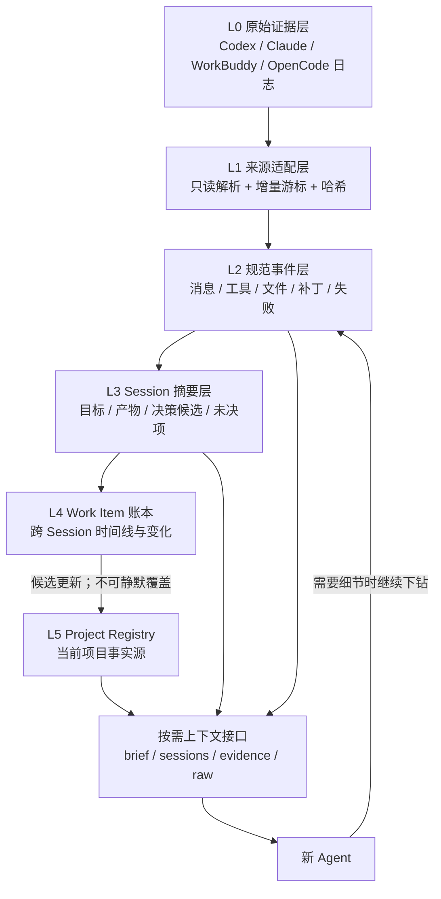

# 技术储备：基于本地日志的 Agent 协作层

状态：技术储备，不进入当前开发排期

记录时间：2026-08-04

当前判断：**链路可行性高；小模型不是前置条件。**

## 1. 一句话定义

不要求不同 Agent 实时互调私有 API，而是把它们已经产生的本地 Session 日志作为追加式证据源，经统一索引和分层加工后，为后续 Agent 提供项目相关的进展、产物、失败与原始出处。

它不是“多个 Agent 互相聊天”，更接近一个异步共享工作台：

> 日志是证据，摘要是投影，项目卡是当前事实源，Agent 按需下钻。

## 2. 为什么现在可以判断“可行”

### B · 内部已验证

- `C:\Users\remo\Desktop\session记录\_INDEX.md` 已归并 Windows Codex 的 12 个线程。
- `WorkBuddy/_INDEX.md` 已索引 17 个 WorkBuddy 会话。
- `WSL-Agents/_INDEX.md` 已索引 Claude Code 11 个、Codex CLI 13 个、OpenCode 15 个会话。
- 当前索引合计 68 个 Session，已经具备标题、时间范围、消息数量、来源 Agent、工作目录和导出文件。
- Windows Codex、WorkBuddy、WSL Codex、Claude、OpenCode 的原始数据入口均仍存在。
- 以当前长期 Codex Session 的原始 rollout 为样本，可以直接统计到：528 个 `function_call`、528 个 `function_call_output`、146 个 `patch_apply_end`、3 个 `turn_aborted`、37 个 `web_search_end`、179 个 `mcp_tool_call_end`。这说明工具、结果、补丁和失败不是只能从自然语言猜测，而是已有结构化事件。
- PAOS 已有四位 Project / Work Item / Session 结构；`PAOS Session Handshake Protocol v1` 又使新 Session 在开始时就获得 `project_id`、`work_item_id` 和 `handshake_id`，未来不必再为新日志猜测归属。

### C · 合理推断

- 在原始日志之上建立只读适配器、增量游标和派生摘要，不需要改造各 Agent 本体。
- 只要派生产物保留 Session、事件位置、文件路径和时间戳，就能让另一个 Agent 从项目摘要逐级回查到行级证据。
- 先给 Agent 几百到几千 Token 的项目上下文包，再按需打开具体 Session 或事件，通常会比每次扫描完整日志显著节省上下文；节省比例尚未实测。
- 这条路线比复制各家原始 API 通讯流更稳定地保留“真实发生过什么”，但时效性是异步的，不等同于实时 Agent 总线。

### D · 后续实施前待核

- 四种日志格式升级后的兼容性和稳定字段。
- OpenCode SQLite 对工具调用、结果和补丁的实际保留粒度。
- WorkBuddy 与 Claude 的事件 ID、父子关系和增量游标是否长期稳定。
- 一份项目上下文包实际能节约多少 Token 和检索时间。
- WSL 与 Windows 两侧持续读取时的权限、文件锁、路径映射和性能。

## 3. 正确的分层，而不是让 Agent 自己翻日志



核心不是把 500KB 日志交给 Agent，而是让 Agent 从最小上下文开始：

| 深度 | 默认给什么 | 典型用途 |
|---|---|---|
| `brief` | 项目状态、当前 Work、最近变化、未决项、Session 指针 | 新 Session 快速接手 |
| `sessions` | 相关 Session 的一段摘要、产物和时间线 | 了解前人做过什么 |
| `evidence` | 指定工具调用、文件变更、错误和原文片段 | 核对结论或排错 |
| `raw` | 原始 JSONL / SQLite 记录位置 | 极少数审计与深挖 |

默认“给”上下文，而不是让 Agent 自己“找”全部上下文。

## 4. 与当前握手协议如何接上

当前握手只解决 Session 的进入：

```text
Project / Work
    ↓ 生成握手 Prompt
新 Session 获得明确归属
    ↓
PAOS 保存真实 Session 元数据
```

未来日志协作层可以补上 Session 的运行和退出：

```text
进入：handshake receipt
  ↓
运行：原始日志持续追加，适配器记录增量游标
  ↓
退出：生成 session checkpoint 候选
  ↓
投影：更新 Work Item 时间线与项目变化候选
```

未来最有价值的协议扩展不是“Agent 互相发消息”，而是 `Session Closure / Checkpoint`：

- 本轮形成的产物；
- 改动过的文件；
- 运行过的测试；
- 关键工具失败；
- 仍未解决的问题；
- 原始日志的结束游标；
- 所有结论对应的证据指针。

握手负责“你是谁、来做什么”，Checkpoint 负责“你做了什么、下一位从哪里继续”。两者合起来才是完整的异步 Agent 协作协议。

## 5. 单一事实源与写入边界

必须继续坚持：

```text
Raw Log        = 发生过什么的证据，不可静默改写
Derived Event  = 适配器解析结果，可重建
Session Digest = 摘要候选，可丢弃或重算
Work Ledger    = 跨 Session 的工作投影
Project Card   = 当前状态的唯一事实源
Human Fields   = 只由用户决定
```

未来日志处理器和小模型都不能直接修改：

- 飞书原始要求；
- 当前唯一承诺；
- DDL 与优先级；
- 项目名称和 Area；
- 已确认的人工决策。

它们只产生带出处的候选。否则四个 Agent 会从“打通信息壁”退化为“四份互相覆盖的项目状态”。

## 6. 不需要小模型也能先完成的部分

规则与结构化解析已经足够做：

- 发现新增/变化的 Session；
- 记录来源 Agent、Session ID、时间范围、工作目录和日志路径；
- 抽取工具名、命令类别、退出码和错误类型；
- 抽取改动文件、补丁事件、测试命令与结果；
- 按 `handshake_id / project_id / work_item_id` 确定新 Session 归属；
- 生成“哪些 Session 可能相关”的候选；
- 按文件、时间、Work Item 建反向索引；
- 提供带 Token 预算的上下文清单。

这些确定性工作先做好，价值已经很高，也更容易测试和回滚。

## 7. 小模型未来适合做什么

小模型是可替换的加工器，不是系统核心：

适合：

- 去掉系统注入和重复噪声；
- 将一个 Session 分段并命名；
- 从结构化事件生成短摘要；
- 归并“改了什么 / 得到什么 / 为什么失败”；
- 给出 Project / Work 关联候选和理由；
- 把长工具轨迹压成可供大模型选择的证据目录。

不适合直接决定：

- 哪条结论成为项目事实；
- 项目优先级和当前唯一承诺；
- 冲突结论谁正确；
- 是否删除、移动或覆盖原始日志；
- 是否把工作资料跨越隐私边界送入外部模型。

即使以后部署本地小模型，输出也应带 `model / prompt_version / source_event_ids / generated_at`，并且能够删除后由原始日志重建。

## 8. 真正可能产生的协作能力

### 8.1 “从上次看到这里之后发生了什么”

Agent 不需要重读整个项目，只请求某个 revision 或日志游标之后的变化：新增 Session、改动文件、完成测试、失败和新决策候选。

### 8.2 文件级跨 Agent 时间线

查询一个文件被哪些 Session、哪些 Agent、在什么时间改过，以及每次对应的 patch、测试和失败。这比聊天摘要更适合工程排错。

### 8.3 决策出处回放

项目卡的一条进展可以反查：Work Item → Session 摘要 → 工具/消息事件 → 原始日志。Agent 不必相信一段无来源的“前情提要”。

### 8.4 冲突与重复劳动提示

当两个活跃 Session 同时编辑相同文件、研究相同问题或提出互斥结论时，系统只提示冲突和证据，不自动替用户裁决。

### 8.5 面向网页 Agent 的上下文包

本地 Agent 可直接获得资料导航；不能访问本机文件的网页 Agent，可获得脱敏的 Markdown/ZIP 上下文包。包内仍使用同一套 Project / Work / Session / evidence 指针。

## 9. 主要风险

| 风险 | 可能后果 | 储备方案 |
|---|---|---|
| 日志含 Key、公司地址、个人内容 | 摘要层扩大泄露面 | 原始日志与派生数据都留在 `private-data`；Secret Store 永不扫描；外部模型前单独脱敏 |
| 每次全量解析 | 慢、重复耗时 | 按文件大小、mtime、事件游标和哈希做增量 |
| 摘要失真 | 后续 Agent 继承错误 | 摘要只作候选；保留事件 ID 与原始路径；支持一键下钻 |
| 多 Agent 同时更新项目卡 | 状态分叉或覆盖 | Project Registry 保持单一事实源；只开放窄写接口与 revision |
| 适配器随版本失效 | 某来源突然漏数据 | 每个来源保存 schema 样本和契约测试；失败时降级为“仅 Session 索引” |
| 把全量日志塞给模型 | Token 与时间失控 | 默认 brief，按需逐层展开；raw 永不作为默认上下文 |
| 系统再次成为研究黑洞 | 元工作吞噬真实项目 | 只有真实出现跨 Agent 接手摩擦时，才启动最小实验 |

## 10. 未来最小实验，不是现在的开发计划

触发条件：真实项目中反复出现“新 Agent 不知道前一个 Agent 做了什么”，并且项目卡 + 握手 Prompt 仍不足以接手。

届时只做一个项目、三条 Session、两种来源：

1. 只读解析，不移动和复制原始日志；
2. 不接模型；
3. 输出一个 `project-context-pack.json/md`；
4. 内容只有 Session 摘要骨架、文件变化、工具失败、未决项和证据指针；
5. 让一个未参与过项目的 Agent 接手，观察它是否无需读取原始日志就能正确回答：
   - 最近完成了什么；
   - 改过哪些文件；
   - 什么失败过；
   - 下一步从哪里继续；
   - 每个判断的出处在哪里。

只有这个无模型版本产生真实收益，才评估是否加入本地小模型做摘要加工。

## 11. 当前冻结结论

- 日志型 Agent 协作在现有资产上具备较高可行性。
- 新 Session 的项目归属已经能由握手协议确定；历史 Session 继续允许人工/候选关联。
- 当前不开发日志总线、不持续监听、不部署小模型。
- 当前及可预见阶段不开发 Agent CLI 启动器或自动调度；一键复制 Prompt + 用户手动粘贴是冻结交互边界。
- 当前 PAOS 仍以 Project Registry 为事实源，日志只作为证据储备。
- 未来优先验证“分层上下文是否减少接手成本”，而不是追求日志吞吐量或模型参数规模。
